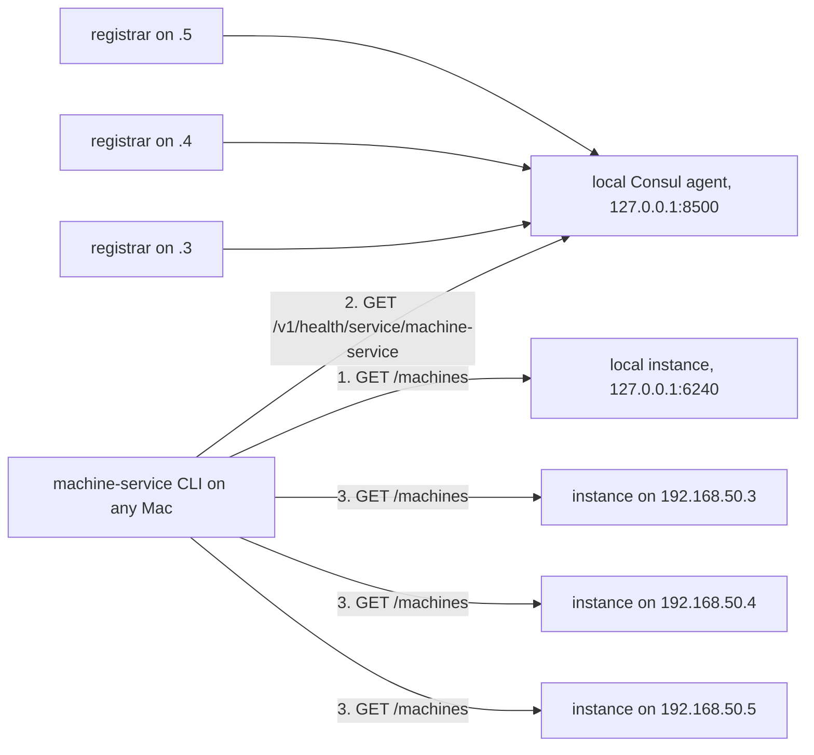

# Discovery and federation (FD)

## Why

- machine-service runs on three Mac minis (DC-20). A person or an agent on any of them should see every machine on the intranet in one list, and lease any of them (DC-21).
- The intranet already has a registry: every Mac runs a Consul agent and the service-catalog registrar, which copies the Mac's described launchd services into Consul. vm-service on 192.168.50.3 is registered there today as `vm-service`, which the coordinated switch replaces with `machine-service` ([MG-3](rename.md#mg-3-one-coordinated-switch)).
- Federation is therefore done by the client, from Consul. Instances never call one another and never schedule work onto another Mac (DC-30).

## FD-1: Registration

- Each instance is registered by the service-catalog registrar on its own Mac, from a description file at `~/.config/service-catalog/services/machine-service.json`. machine-service does not talk to Consul itself.
- The description names the Consul service `machine-service`, the supervisor `com.wezzard.machine-service`, port 6240 and the health path `/health`.
- The description's tags say what the instance offers. Every instance carries `machines` and `agents`. An instance with durable exposure on also carries `durable` (DC-39). An instance that can create virtual machines also carries `vm` and `tart`. Consul shows tags as they are in the file, so the tags are written per Mac: 192.168.50.3 carries `vm` and `tart` without `durable`, and 192.168.50.4 and 192.168.50.5 carry `durable`.
- `machine-service-install catalog-description` prints the description for the Mac it runs on, with the tags that its exposure setting and its capability check warrant. The operator places the file. The installer never writes into service-catalog's folder, because service-catalog's files belong to it.
  - The exposure setting is `--expose-durable on|off` when given, else the installed LaunchAgent's `MACHINE_SERVICE_EXPOSE_DURABLE`, else off (DC-60).
  - The capability check reads the installed LaunchAgent's environment: Tart is found as the installer finds it, the image catalog is built with the daemon's own strict builder ([IC-4](image-catalog.md)), and at least one line's base VM must be listed by `tart list` in the selected store.
  - The command explains each tag on standard error and warns when the instance binds loopback. `services/machine-service.json` in this repository is the command's output for a Mac with Tart and images and exposure off.
- The instance must bind all interfaces, `MACHINE_SERVICE_HOST=0.0.0.0`, to be reachable from the other Macs. The registrar then publishes `loopback_only: false`. An instance bound to loopback is registered, but the CLI on another Mac reports it as not reachable.
- `GET /health` answers `{"ok": true, "service": "machine-service", "instance": "<instance ID>", "kinds": [...]}`. `kinds` holds `"durable"` when exposure is on and `"virtual"` when the instance can create virtual machines.

## FD-2: Discovery

- The CLI always asks the local instance first, at the configured address, which defaults to `http://127.0.0.1:6240`. This works with no Consul agent.
- The CLI then asks the local Consul agent for every registered instance, healthy or not, with `GET /v1/health/service/machine-service`. The agent's address is `CONSUL_HTTP_ADDR`, Consul's standard variable, and defaults to `http://127.0.0.1:8500`.
- The local instance and its Consul registration are the same instance when their instance IDs match. The CLI lists it once. The ports must match too, so that a second instance on the same Mac stays a separate instance, and the CLI then names both `<instance ID>:<port>` (DC-61).
- The local instance's ID is the `instance` of its `/health`. Before an instance reports it, the CLI uses the local Consul agent's node name from `GET /v1/agent/self`, and without Consul the Mac's local host name (DC-61).
- `--local` limits the CLI to the local instance. `--instance <ID or address>` limits it to one instance.

## FD-3: Aggregation

- The CLI sends `GET /machines` to every discovered instance at once, with a timeout of 5 seconds each, and merges the answers into one list ([CL-1](../ux/cli/list.md#cl-1-the-machine-list)).
- The 5 seconds are one budget for every request to an instance, and the Consul agent has its own 5 seconds, so a list takes at most about 10 seconds whatever is down. The requests ignore proxy variables and follow no redirect (DC-62).
- A registration that the registrar published as `loopback_only` on another Mac is not asked. Its row says `bound to loopback on <node>` (DC-62).
- When the Consul agent does not answer, the CLI says so on standard error and lists the local instance.
- An instance that does not answer stays in the list as `unreachable`, with the error and its Consul health status. An empty answer would read as "this Mac has no machines" and send someone to rebuild what already exists, which the service-catalog design warns against.
- The merged list is a view at one moment. A machine shown as available may be leased by the time a client asks for it, and the acquisition then fails with its usual refusal.

## FD-4: Working on a remote instance

- A client works on a machine through the instance that owns it, at the address Consul gives for that instance. Every operation of the HTTP API works the same over the LAN as on loopback.
- A host path on the client's Mac means nothing to an instance on another Mac. Two byte-carrying endpoints therefore serve remote clients, for both kinds of machine:
  - `PUT /machines/<name>/files?lease_id=<id>&path=<remote path>` takes the file's bytes as the request body with `Content-Type: application/octet-stream`, or a directory as a tar stream with `Content-Type: application/x-tar`. The `X-Content-SHA256` header carries the digest of the body. The instance writes to a temporary sibling, checks the digest, and renames the result into place.
  - `GET /machines/<name>/files?lease_id=<id>&path=<remote path>` returns a file's bytes, or a directory as a tar stream, with the digest in `X-Content-SHA256`.
  - `name` names the item when `path` is an existing folder; it defaults to the last part of `path`. `GET` answers the item's name in `X-Content-Name`.
- The instance checks the machine, and on a durable machine the lease, before it keeps a byte. It stages the body under `<state>/transfers/<id>/`, refuses a body whose digest differs with 400 and writes nothing, and then runs its path-based transfer on the staged path. The staging folder is removed when the request ends (DC-70).
- A tar stream carries the folder's contents, regular files and folders only. A stream that names an absolute path, a `..` component, a link or a device is refused whole (DC-71).
- On a virtual machine the instance moves the bytes over its guest link ([GS](guest-session.md)). On a durable machine it reads and writes the local file system.
- Path-based push and pull serve loopback clients only, for both kinds of machine: from another Mac a host path would name the service host's own files (DC-70).
- The CLI's `push` and `pull` use the byte-carrying endpoints whenever the machine's owner is another instance or not on loopback, and with `--bytes` on loopback (DC-78). Loopback clients may keep the path-based push and pull.
- A client on an unreliable network can use the remote session ([RS](remote-session.md)), which already carries file bytes and execution IDs. On the home LAN the HTTP API is enough.

## FD-5: Trust

- The HTTP API has no authentication today. LAN exposure assumes the household trust model, the same as the LLM gateway.
- On a durable machine this exposure is larger than on a virtual machine. Any device on 192.168.50.0/24 that can reach port 6240 can acquire a durable machine and run commands on the Mac itself as `wezzard`, an admin account. On a virtual machine the same request runs only inside a disposable guest.
- The boundaries that exist today are the Wi-Fi's MAC address whitelist, which limits who joins the network, and the bind address: an instance bound to loopback cannot be reached from another Mac.
- The remote session listener of [RS-1](remote-session.md#rs-1-transport) requires TLS and a client credential off loopback. That requirement covers only that listener, not the HTTP API.
- This design keeps household trust for the HTTP API, as the owner set it for vm-service.

## FD-6: No scheduling between instances

- An instance leases only its own durable machine and its own virtual machines.
- A client chooses the machine. The CLI helps by filtering the merged list by capability ([CL-2](../ux/cli/list.md#cl-2-acquire-by-capability)), and it then acquires from the instance that owns the chosen machine.
