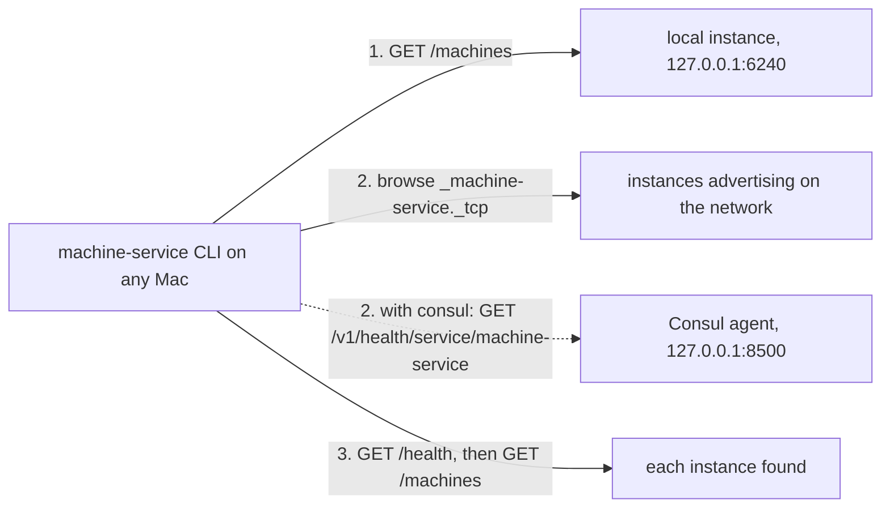

# Discovery and federation (FD)

## Why

- machine-service runs on three Mac minis (DC-20). A person or an agent on any of them should see every machine on the intranet in one list, and lease any of them (DC-21).
- A Mac on the network finds the instances without any infrastructure: each instance advertises itself with Bonjour, the network's own discovery (DNS-SD over Multicast DNS, RFC 6763 and RFC 6762), and the CLI browses for it (DC-84).
- An operator who centralises discovery uses Consul instead, through one switch: the instances stop advertising and the CLI asks the Consul agent, as the service-catalog registrar registers every Mac's described services there (DC-84).
- Federation is done by the client in both modes. Instances never call one another and never schedule work onto another Mac (DC-30).

## FD-1: Advertisement and registration

- `MACHINE_SERVICE_DISCOVERY` chooses the mode, `bonjour` or `consul`, on the daemon and on every client alike; it defaults to `bonjour`. Any other value stops the daemon at startup, and the CLI with an error that names the two values (DC-84).
- **Bonjour.** The daemon advertises itself while it serves, through the Mac's own DNS-SD service (`DNSServiceRegister`, which mDNSResponder answers), so the system handles name conflicts, sleep and the goodbye on exit (DC-85):
  - the service type is `_machine-service._tcp`, the instance name is the instance ID ([MM-2](machines.md#mm-2-identity)), and the port is the daemon's port;
  - the TXT record carries `txtvers=1`, `instance=<instance ID>` and `kinds=<kinds>`, the `kinds` of `/health` joined by commas, and nothing else;
  - an instance bound to loopback advertises nothing, because no other Mac could reach it, and logs why;
  - the advertisement is withdrawn when the daemon stops, and a crashed daemon's records expire with their time to live.
- **Consul.** The daemon advertises nothing. Each instance is registered by the service-catalog registrar on its own Mac, from a description file at `~/.config/service-catalog/services/machine-service.json`; machine-service does not talk to Consul itself (DC-81).
  - The description names the Consul service `machine-service`, the supervisor `com.wezzard.machine-service`, port 6240 and the health path `/health`.
  - The description's tags say what the instance offers. Every instance carries `machines` and `agents`. An instance with durable exposure on also carries `durable` (DC-39). An instance that can create virtual machines also carries `vm` and `tart`.
  - `machine-service-install catalog-description` prints the description for the Mac it runs on, with the tags that its exposure setting and its capability check warrant. The operator places the file. The installer never writes into service-catalog's folder, because service-catalog's files belong to it. The exposure setting is `--expose-durable on|off` when given, else the installed LaunchAgent's `MACHINE_SERVICE_EXPOSE_DURABLE`, else off (DC-60).
  - The description also carries `meta`, `{"instance": "<instance ID>"}`, which the registrar publishes in the registration's service metadata (DC-80, DC-81).
  - `catalog-description` explains each tag on standard error and warns when the instance binds loopback; the registrar then publishes `loopback_only: true`, and the CLI on another Mac reports the instance as not reachable. `services/machine-service.json` in this repository is the command's output for a Mac with Tart and images and exposure off.
- In both modes the instance must bind all interfaces, `MACHINE_SERVICE_HOST=0.0.0.0`, to be reachable from the other Macs.
- `GET /health` answers `{"ok": true, "service": "machine-service", "instance": "<instance ID>", "kinds": [...]}`. `kinds` holds `"durable"` when exposure is on and `"virtual"` when the instance can create virtual machines.

## FD-2: Discovery

- The CLI always asks the local instance first, at the configured address, which defaults to `http://127.0.0.1:6240`.
- **Bonjour.** The CLI then browses `_machine-service._tcp` in `local.` for 2 seconds, through the system's DNS-SD service (`DNSServiceBrowse`, then `DNSServiceResolve` for each instance), and takes each instance's host, port and TXT record. No Consul agent is needed, and none is asked (DC-84, DC-85).
- **Consul.** The CLI then asks the local Consul agent for every registered instance, healthy or not, with `GET /v1/health/service/machine-service`. The agent's address is `CONSUL_HTTP_ADDR`, Consul's standard variable, and defaults to `http://127.0.0.1:8500`. A registration's instance ID is the `instance` its service metadata states, never the Consul node; a registration that states none falls back to its node name, and the CLI says so on standard error, naming the node and the fix (DC-80).
- **Confirming an instance.** Before it uses an instance it found, the CLI asks its `/health` and keeps it only when the answer is machine-service and its `instance` is the advertised or registered ID. A mismatch is listed as unreachable with the two IDs. Finding an address proves nothing about who answers there (DC-85). Once instances state `machine_id`, the confirmation compares the machine ID instead, and a new name under the same ID is a rename ([MI-5](identity.md#mi-5-clients)).
- The local instance and a found instance are the same instance when their instance IDs and ports match. The CLI lists it once. A second instance on the same Mac stays separate, and the CLI then names both `<instance ID>:<port>` (DC-61).
- The local instance's ID is the `instance` of its `/health`. Before an instance reports it, the CLI uses the Mac's local host name (DC-80).
- `--local` limits the CLI to the local instance. `--instance <ID or address>` limits it to one instance.
- A program that lists or leases machines, such as mcp-relay, follows the same rule in the same mode: the local instance, then the instances that Bonjour or Consul lists, each confirmed by its `/health` (DC-85).

## FD-3: Aggregation

- The CLI sends `GET /machines` to every discovered instance at once, with a timeout of 5 seconds each, and merges the answers into one list ([CL-1](../ux/cli/list.md#cl-1-the-machine-list)).
- The 5 seconds are one budget for every request to an instance, and the browse its own 2 seconds, or the Consul agent its own 5 seconds, so a list takes at most about 10 seconds whatever is down. The requests ignore proxy variables and follow no redirect (DC-62).
- A registration that the registrar published as `loopback_only` on another Mac is not asked. Its row says `bound to loopback on <node>` (DC-62).
- In Consul mode, when the Consul agent does not answer, the CLI says so on standard error and lists the local instance. In Bonjour mode, when the browse finds no other instance, the CLI says on standard error how many instances answered, so an empty list is never mistaken for a network without machines.
- An instance that does not answer stays in the list as `unreachable`, with the error, and in Consul mode with its Consul health status. In Bonjour mode a stopped instance withdraws its advertisement and leaves the list; one that crashed stays `unreachable` until its records expire. An empty answer would read as "this Mac has no machines" and send someone to rebuild what already exists, which the service-catalog design warns against.
- The merged list is a view at one moment. A machine shown as available may be leased by the time a client asks for it, and the acquisition then fails with its usual refusal.

## FD-4: Working on a remote instance

- A client works on a machine through the instance that owns it, at the address discovery gives for that instance ([FD-2](#fd-2-discovery)). Every operation of the HTTP API works the same over the LAN as on loopback.
- A host path on the client's Mac means nothing to an instance on another Mac. Two byte-carrying endpoints therefore serve remote clients, for both kinds of machine:
  - `PUT /machines/<name>/files?lease_id=<id>&path=<remote path>` takes the file's bytes as the request body with `Content-Type: application/octet-stream`, or a directory as a tar stream with `Content-Type: application/x-tar`. The `X-Content-SHA256` header carries the digest of the body. The instance writes to a temporary sibling, checks the digest, and renames the result into place.
  - `GET /machines/<name>/files?lease_id=<id>&path=<remote path>` returns a file's bytes, or a directory as a tar stream, with the digest in `X-Content-SHA256`.
  - `name` names the item when `path` is an existing folder; it defaults to the last part of `path`. `GET` answers the item's name in `X-Content-Name`.
- The instance checks the machine, and on a durable machine the lease, before it keeps a byte. It stages the body under `<state>/transfers/<id>/`, refuses a body whose digest differs with 400 and writes nothing, and then runs its path-based transfer on the staged path. The staging folder is removed when the request ends (DC-70).
- A tar stream carries the folder's contents, regular files and folders only. A stream that names an absolute path, a `..` component, a link or a device is refused whole (DC-71).
- On a virtual machine the instance moves the bytes over its guest link ([GS](guest-session.md)). On a durable machine it reads and writes the local file system.
- Path-based push and pull serve loopback clients only, for both kinds of machine: from another Mac a host path would name the service host's own files (DC-70).
- The CLI's `push` and `pull` use the byte-carrying endpoints whenever the machine's owner is another instance or not on loopback, and with `--bytes` on loopback (DC-78). Loopback clients may keep the path-based push and pull.
- A client on an unreliable network can use the remote session ([RS](remote-session.md)), which already carries file bytes and execution IDs. On the home LAN the HTTP API is enough.

## FD-5: Trust

- The HTTP API has no authentication today. LAN exposure assumes the household trust model, the same as the LLM gateway.
- On a durable machine this exposure is larger than on a virtual machine. Any device on 192.168.50.0/24 that can reach port 6240 can acquire a durable machine and run commands on the Mac itself as `wezzard`, an admin account. On a virtual machine the same request runs only inside a disposable guest.
- The boundaries that exist today are the Wi-Fi's MAC address whitelist, which limits who joins the network, and the bind address: an instance bound to loopback cannot be reached from another Mac.
- The remote session listener of [RS-1](remote-session.md#rs-1-transport) requires TLS and a client credential off loopback. That requirement covers only that listener, not the HTTP API.
- This design keeps household trust for the HTTP API, as the owner set it for vm-service.

## FD-6: No scheduling between instances

- An instance leases only its own durable machine and its own virtual machines.
- A client chooses the machine. The CLI helps by filtering the merged list by capability ([CL-2](../ux/cli/list.md#cl-2-acquire-by-capability)), and it then acquires from the instance that owns the chosen machine.
