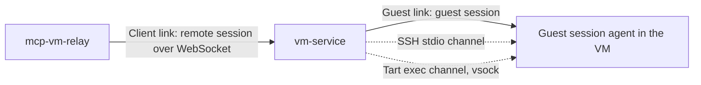

# Index of architecture

## Table of Contents

- Links
- Tests

## Links

vm-service sits between two links. The client link joins a client to vm-service; the guest link joins vm-service to a leased VM. Terms are defined in the [glossary](../glossory.md).

1. GS: [Guest session](guest-session.md). One long-lived, checksummed stream per lease replaces one SSH connection per operation. Two channels carry it: SSH stdio and Tart exec.
2. RS: [Remote session](remote-session.md). A resumable WebSocket session with heartbeats and execution IDs carries operations across unreliable networks, at most once.

## Tests

1. TL: [Test layers](test-layers.md). Each behaviour is tested on the layer that owns it: unit, component integration, network lab, live VM, and end to end.
