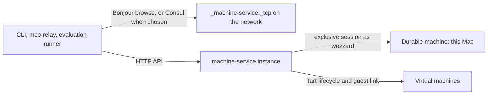
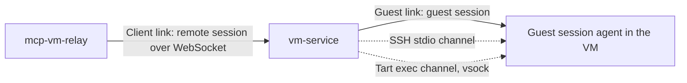

# Index of architecture

## Table of Contents

- Machines
- Links
- Tests

## Machines

vm-service becomes machine-service (DC-19). An instance leases the Mac it runs on as a durable machine when its operator turns exposure on (DC-39), and the virtual machines it can create (DC-22).

1. MM: [Machine model](machines.md). Durable and virtual machines, their identity, and the capability report that consumers choose by.
2. DM: [Durable machine leases](durable-machine.md). A lease is an exclusive session with a scratch workspace; commands run as `wezzard` in the GUI session, not over SSH.
3. AK: [Agent keys](agent-keys.md). Claude Code and Codex reach the LiteLLM gateway with a stable key per machine per agent, never printed.
4. HY: [Hygiene and CI coexistence](hygiene.md). A workspace, a leftover-process sweep, and a recorded inventory before and after; the CI runner is never paused.
5. FD: [Discovery and federation](federation.md). Bonjour advertisement by default or Consul registration by choice, the CLI's merged list, remote work, and the household trust model.
6. CN: [Consumers](consumers.md). What mcp-relay and the evaluation runner change to use durable machines.
7. MG: [Rename and migration](rename.md). The names, the removal of `/vms`, and the one coordinated switch of the service and its callers.
8. IC: [Image catalog hot reload](image-catalog.md). Image lines, bases and associations change the available virtual machines without a restart.
9. IN: [Installation](installation.md). One layout lists every executable beside the daemon; the daemon resolves its helpers from it and the installer installs exactly it.

## Links

vm-service sits between two links. The client link joins a client to vm-service; the guest link joins vm-service to a leased VM. Terms are defined in the [glossary](../glossory.md).

1. GS: [Guest session](guest-session.md). One long-lived, checksummed stream per lease replaces one SSH connection per operation. Two channels carry it: SSH stdio and Tart exec.
2. RS: [Remote session](remote-session.md). A resumable WebSocket session with heartbeats and execution IDs carries operations across unreliable networks, at most once.

## Tests

1. TL: [Test layers](test-layers.md). Each behaviour is tested on the layer that owns it: unit, component integration, network lab, live VM, end to end, and live durable machine.
