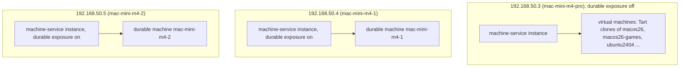

# Machine model (MM)

## Why

- vm-service leases only Tart virtual machines on the Mac it runs on.
- Some work needs what a Tart VM cannot give. An Unreal post-process evaluation needs Metal 3, and a Tart VM's paravirtual GPU supports only the `mac2` and `common3` Metal families, with argument buffers tier 1 (DC-27).
- Two of the three Mac minis, 192.168.50.4 and 192.168.50.5, have no Tart and no images, so today they cannot serve any lease at all (DC-20).
- machine-service therefore leases two kinds of machine through one API: the Mac the instance runs on, and the virtual machines that instance can create (DC-22).

## MM-1: Two kinds of machine

- A **durable machine** is the Mac that a machine-service instance runs on. It exists before a lease and after it. A lease on it is an exclusive session with a scratch workspace ([DM](durable-machine.md)).
- A **virtual machine** is a Tart clone that the instance creates for one lease and destroys at release. Its behaviour is today's vm-service lease, unchanged.
- An instance offers at most one durable machine: the Mac it runs on.
- Exposure is local configuration of each instance and is off by default (DC-39). The operator turns it on with `MACHINE_SERVICE_EXPOSE_DURABLE=on` in the instance's LaunchAgent environment, which `machine-service-install --expose-durable on` writes and later installations preserve.
- An instance with exposure off lists no durable machine, answers an acquisition that names its Mac with HTTP 404 and the error `durable machine not exposed on <instance>`, and reports no `durable` kind in `/health` or in Consul ([FD-1](federation.md#fd-1-registration)).
- Today 192.168.50.3 keeps exposure off and offers only its Tart VMs. 192.168.50.4 and 192.168.50.5 turn exposure on.
- An instance offers virtual machines only when it can create them. It can create them when Tart is installed, at least one image line is configured, and that line's base VM exists in the selected Tart store. Today only 192.168.50.3 qualifies.
- The kinds are named `durable` and `virtual` in every response. The words "bare metal" and "physical machine" are not used anywhere in the API, the CLI or the documents (DC-22).

## MM-2: Identity

- An **instance ID** is the Mac's own name, its local host name, and reported as `instance` in `/health` (DC-80). It is a label that follows the Mac live; the permanent identity is the machine ID, the Mac's hardware UUID, as [MI](identity.md) sets (DC-86 to DC-90).
- The Consul node name is not the instance ID. It comes from the Consul agent's own configuration and need not equal the local host name: on 192.168.50.3 the node is `mac-mini-m4-pro` and the local host name is `Mac-mini`. An instance therefore states its ID in its Consul registration, and a client recognizes it by that ([FD-1](federation.md#fd-1-registration), [FD-2](federation.md#fd-2-discovery)).
- A durable machine's name is its instance ID. A Mac has one durable machine, so the name is unique on the intranet.
- A virtual machine keeps today's name, `pilot-mac-<purpose>-<random>` or `pilot-<purpose>-<random>`. Two instances could create the same name, so the CLI qualifies a virtual machine as `<vm>@<instance>` whenever it lists more than one instance.
- A durable machine also reports its `hardware_uuid`, the `IOPlatformUUID` of the Mac. A client can tell from it that a host name now belongs to another Mac.
- Every lease has the immutable `lease_id` that acquisition already issues ([acquisition contract](../acquisition-contract.md#new-lease-identity-and-reporting)).
- Every operation on a durable machine must carry the `lease_id` of the current lease. The machine outlives each lease, so its name alone cannot tell a current lease from a finished one. A missing or stale `lease_id` is refused with HTTP 409 and nothing runs.
- Operations on a virtual machine accept `lease_id` and do not require it, as today.

## MM-3: Capability report

- A machine record carries every field that a virtual machine's lease record carries today: `name`, `lease_id`, `purpose`, `image`, `image_kind`, `state`, `created_at`, `ttl_hours`, `ttl_expires_at`, `grace_until`, `warned`, `env`, `ip`, `cpu`, `memory_mb`, `disk_gb` and `configuration`. A field with no meaning for a durable machine is `null`, such as `image`.
- A machine record adds `kind` (`durable` or `virtual`), `instance` (the instance ID) and `capabilities`.
- `capabilities` is one object with a `schema_version` of 1 and the sections below. A fact that the instance could not observe is `null`, and its reason is listed in `unknown`. The instance never guesses a fact.

| Section | Fields | Source on a durable machine |
| --- | --- | --- |
| `os` | `name`, `version`, `build` | `sw_vers` |
| `hardware` | `chip`, `cpu_cores`, `memory_bytes`, `hardware_uuid` | `sysctl`, `ioreg` |
| `disk` | `total_bytes`, `free_bytes` of the system volume | `statfs` on `/` |
| `gpu` | `name`, `metal_families` (for example `apple9`, `mac2`, `common3`, `metal3`), `metal3` (boolean), `argument_buffers_tier` | a small helper that asks `MTLCreateSystemDefaultDevice` for `supportsFamily` and `argumentBuffersSupport` |
| `display` | `console_user`, `gui_session` (boolean), `screen_locked` | `/dev/console` owner, and the `CGSSessionScreenIsLocked` key of the service user's session in `ioreg`'s `IOConsoleUsers` (DC-77) |
| `software` | `node`, `cua_driver`, `claude_code`, `codex`, `tart`, each a version or `null`; `xcode`, `unity`, `unreal`, each a list of installed versions with their paths | version commands run in the login environment; the standard install folders of Xcode, Unity Hub and the Epic launcher |
| `permissions` | `screen_recording`, `accessibility`, `post_event`, each `granted`, `denied` or `unknown` for the service's own executable | `CGPreflightScreenCaptureAccess`, `AXIsProcessTrusted`, `CGPreflightPostEventAccess` |
| `agents` | `claude_code`, `codex`, each `{ "key": "present" \| "absent" \| "unsafe-mode" \| "invalid", "endpoint": "present" \| "absent" \| "invalid" }` | the key files' existence and modes and `endpoints.json` ([AK-1](agent-keys.md#ak-1-key-files), [AK-2](agent-keys.md#ak-2-gateway-endpoints-are-local-configuration)); never a key |
| `ci_runner` | `present`, `busy`, `name` | `~/actions-runner/.runner` and a running `Runner.Worker` process ([HY-5](hygiene.md#hy-5-coexistence-with-the-ci-runner)) |
| `observed_at` | the time of each section's last observation | the instance's clock |

- A virtual machine's capabilities come from its image, not from a probe of a running guest. The `gpu` section of a macOS virtual machine is the measured paravirtual device: families `mac2` and `common3`, `metal3` false, argument buffers tier 1. A Linux guest has no Metal device. Its `software` section comes from the image's validated application inventory (`GET /applications`); without one it is `null` with the reason. `os`, `hardware` and `disk` carry the line's kind and resource defaults, `network` is `nat`, `source` is `image`, and the facts only a running guest could answer (`display`, `permissions`, `agents`, `ci_runner`, `os.version`) are `null` with their reasons (DC-67).
- `GET /machines` reports, per instance, the virtual machine **offers** as well as the existing ones, under `offers`: one entry per image of the current image catalog ([IC](image-catalog.md)), with `kind: "virtual"`, `state: "offer"`, `name` and `image` (the image), `image_kind`, `base_vm`, `base_available`, `defaults`, the image's capabilities and the `concurrency` figures of `GET /images` (`running`, `limit`, `acquirable`). A consumer can therefore compare "a fresh macOS 26 VM on mac-mini-m4-pro" with "the durable machine mac-mini-m4-1" in one list. An instance without Tart or without a catalog lists no offer and says why in `offers_unavailable` (DC-66).
- A durable machine record carries `warnings`, a list of `{code, message}`. Below the free-disk level of `MACHINE_SERVICE_DISK_WARN_GB` (default 30 GiB) it holds `low-free-disk` ([HY-6](hygiene.md#hy-6-free-disk), DC-76).

## MM-4: When facts are observed

- Cheap facts are read on every `GET /machines` request: `disk.free_bytes`, `display`, `ci_runner.busy`, `agents` and the lease state.
- Expensive facts are read at startup, once a day, at the start and the end of every durable lease, and on `POST /machines/<name>/refresh`: `gpu`, `software` and `permissions`.
- A refresh never installs, starts, grants or changes anything. It runs only read-only commands, and each command has a timeout of 30 seconds.

## MM-5: States

- A durable machine is `available`, `leased` or `unavailable`. An instance with exposure off has no durable machine and therefore no durable state.
- A durable machine is `unavailable` when it has no logged-in GUI session for `wezzard`, because a session then cannot reach the window server. The record names the reason in `unavailable_reason`, and an acquisition is refused with 409 `durable machine unavailable: <name> (<reason>)`, a capacity refusal a client may wait on (DC-68). A display that could not be read never makes the machine unavailable. A lease that exists keeps its state. Other shortfalls, such as low free disk, a busy CI runner or a missing permission, are reported as facts and warnings, and they never make the machine unavailable.
- A virtual machine keeps today's states: `pending`, `provisioning`, `running` and `releasing`. An offer has the state `offer`.
